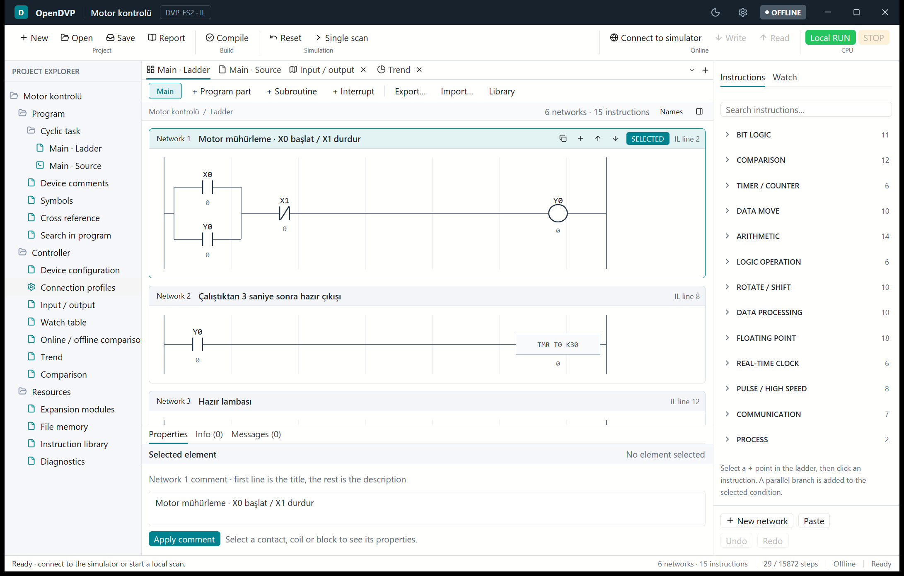
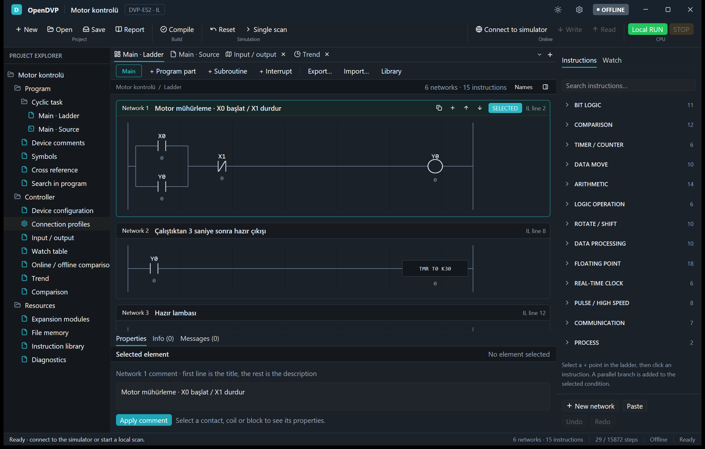

# OpenDVP

[](https://github.com/Gorke07/OpenDVP/releases)


[](LICENSE)

[English](README.md) · [Türkçe](README.tr.md)

An open, offline-first programming workbench for **Delta DVP PLCs** (ES2 / SS2
class), written in Rust with the [GPUI](https://www.gpui.rs/) toolkit.

Write programs as Instruction List (IL), Structured Text (ST) or Ladder, run
them in a built-in scan simulator, compare the result against Delta's own
simulator, and optionally talk to a real controller. An AI assistant can drive
the same workbench through a built-in MCP server.

> **Status: pre-release.** Everything below was verified against the Delta
> simulators that ship with Delta COMMGR 2.11 and the Delta editor. **Downloading a program
> to, forcing values on, and starting/stopping a physical PLC has not been
> tested on real hardware yet.** Windows is the only supported platform.

<p align="center">
  
  
</p>

**Contents:** [Download](#download) · [Features](#features) · [Supported models](#supported-models) ·
[Build and run](#build-and-run) · [Quick tour](#quick-tour) · [Structured Text](#structured-text-example) ·
[Settings](#settings) · [MCP server](#mcp-server) · [Testing](#testing) · [Limitations](#known-limitations)

## Download

Get `OpenDVP-0.1.0-windows-x64.zip` from the
[Releases page](https://github.com/Gorke07/OpenDVP/releases), unpack it and run
`opendvp.exe`. No installer or admin rights are needed. Compare the SHA-256 value with
`SHA256SUMS.txt` from the same release:

```powershell
Get-FileHash .\OpenDVP-0.1.0-windows-x64.zip -Algorithm SHA256
```

## Features

- **Ladder editor** – select networks, add series NO/NC contacts, parallel
  branches, swap coils, add and delete networks, undo/redo. Every edit is
  compiled first; a candidate that does not compile is never applied.
- **Source editors** – IL and ST with search (Ctrl+F), device search, symbol
  addresses, generated-IL view and export. 318 instruction families / 600
  recognised spellings are covered by the compiler and simulator.
- **Structured Text** – `BOOL`, `INT`, `DINT`, `WORD`, `DWORD`, `REAL`, the usual
  statements (`IF`, `CASE`, `FOR`, `WHILE`, `REPEAT`, …) lowered to the same IL
  execution plan. Not a full IEC 61131-3 implementation; unsupported constructs
  produce an explicit error.
- **Scan simulator** – virtual-time execution, watch table, trend (CSV export),
  diagnostics, force/override of inputs, modules (DVP04AD-E2/S2 …), file memory
  (`.odmem`).
- **Differential testing** – the same program is run on the original Delta
  ES2/SS2 simulator and on the local model and the results are compared value
  by value (`es2_compare`).
- **PLC connection** – USB/serial and TCP profiles, X/Y monitoring, SS2
  online RUN/STOP, and a confirmed two-step *program download* (STOP → write →
  read-back verify → optional RUN).
- **File formats** – `.odvp` (OpenDVP project), `.il`, `.st`, `.odmem`, plus
  import of Delta `.dvp` and `.isp` project files and EasyDownload `.dvz`.
- **Built-in MCP server** – ~40 tools so an AI assistant can read the
  instruction reference, edit networks, compile, simulate, and (only with
  explicit confirmation) touch a PLC. See [MCP server](#mcp-server).
- **Light / dark theme**, UI scale, autosave and recovery copies, Turkish and
  English interface.

## Supported models

DVP-ES2, ES2-E, EX2, SS2, SA2, SX2, SE, SE2, EH3 and SV2 profiles with their
device ranges and special M/D tables. The simulator-backed checks cover ES2 and
SS2; the other models use the same compiler with their own limits.

## Requirements

- Windows 10/11 and the Rust toolchain with the MSVC build tools
  (verified with Rust 1.99.1, edition 2024).
- To compare against the original simulators: Delta **COMMGR 2.11** (ES2 and
  SS2 simulators) or the simulators of the Delta editor. They are *not* bundled; only binaries with
  the exact SHA-256 values recorded in the source are accepted.
- Delta binaries and DLLs are never part of this repository.

## Build and run

```powershell
cargo run --locked --release
cargo run --locked --release -- examples/motor.il      # open a file at start
cargo build --locked --release                         # target\release\opendvp.exe
```

The executable is **not code-signed** (v0.1.0); Windows SmartScreen may warn on first run.
Verify a downloaded build against the SHA-256 published with the release.

The default feature `gpui-ui` builds the desktop application. The first build
downloads and compiles GPUI and takes a while.

## Quick tour

1. Start OpenDVP – it opens with the motor-control example.
2. Switch on input **X0** in the right-hand panel and press **F5**. **Y0**
   (motor) turns on and seals itself in.
3. Turn X0 off; the seal-in contact keeps the motor running. After 3 s (T0,
   K30) **Y1** turns on.
4. Turn on **X1**: Y0/Y1 drop out and T0 resets.
5. Press **F7** to compile, **Ctrl+S** to save as `.odvp`.

One simulator step advances **20 ms of virtual time**; it is not a real-time
guarantee.

| Key | Action | Key | Action |
| --- | --- | --- | --- |
| F5 | run / pause | Ctrl+S | save |
| F6 | single scan | Ctrl+O | open |
| F7 | compile | Ctrl+F | find in source |
| Ctrl+K | command palette | F3 / Shift+F3 | next / previous match |
| Ctrl+B / Ctrl+J | toggle network list / inspector | Ctrl+Z | undo |

## Structured Text example

```iecst
PROGRAM Main
VAR
    start AT X0 : BOOL;
    motor AT Y0 : BOOL;
    count AT D20 : INT := 0;
END_VAR
motor := start;
IF motor THEN
    count := count + 1;
END_IF;
END_PROGRAM
```

X/Y numbers are octal as on Delta PLCs (`%IX1.7` is `X17`). More programs are in
[`examples/`](examples/).

## Settings

Open **Settings** from the title bar (the sun/moon icon toggles the theme).
The file lives at `%LOCALAPPDATA%\OpenDVP\settings.txt`.

- **Appearance** – dark theme, UI scale 90–150 %.
- **Files & recovery** – recovery copy every 1/5/10/30 minutes while there are
  unsaved changes (saving deletes it; a recovery copy opens untitled and never
  overwrites the original), default project folder, recent projects.
- **New-project defaults** – PLC model, IL or ST, simulator scan time
  (10–100 ms). The model of an existing project can be changed on the
  *Hardware* tab (CPU card) while no simulator is connected.
- **PLC safety** – a *read-only* switch disables program download, RUN/STOP and
  force, including through MCP. "Reset to defaults" keeps language, recent
  projects and the MCP token.
- **AI (MCP)** – server on/off, port, listening scope and access token.

Continuous online RUN exists only for the verified COMMGR 2.11 **SS2**
simulator; on an ES2 model a single-scan comparison is used instead. Select the
SS2 model for online RUN.

## MCP server

OpenDVP itself is an [MCP](https://modelcontextprotocol.io/) server (built on
`rust-mcp-sdk` 2.x). It starts with the window when enabled in Settings, or
stand-alone:

```powershell
opendvp.exe --mcp-http          # streamable HTTP on http://0.0.0.0:8765/mcp
opendvp.exe --mcp-http=9000     # another port
opendvp.exe --mcp               # stdio transport
```

Client configuration:

```json
{ "mcpServers": { "opendvp": { "type": "http", "url": "http://127.0.0.1:8765/mcp" } } }
```

With an access token add `"headers": { "Authorization": "Bearer <token>" }`.

Tool groups: instruction reference, compile/encode, project and ladder-network
editing (edits that do not compile are rejected), offline simulator, read-only
PLC access, and `window_project_pull` / `window_project_push` to share the
project open in the window. Tools that write to a PLC (`plc_download`,
`plc_set_run`, `plc_force`) refuse to run without `confirm=true` and are
disabled by the *read-only* setting.

> **Security.** The default listening scope is the whole network
> (`0.0.0.0`) and no token is required. On any network you do not fully trust,
> restrict the scope to this computer or create a token in Settings.

## Repository layout

| Path | Contents |
| --- | --- |
| `src/` | compiler, simulator, protocol code, GPUI application, MCP server |
| `src/bin/es2_compare/` | differential tests against the original simulators |
| `examples/` | sample IL/ST programs and runnable Rust probes (`cargo run --example …`) |
| `locales/`, `assets/`, `docs/images/` | UI translations, icon, Windows resources, screenshots |

## Testing

```powershell
cargo test --locked --release
cargo clippy --locked --all-targets -- -D warnings
cargo fmt --check
```

Differential tests against the original simulators (need the Delta simulators):

```powershell
cargo run --locked --bin es2_compare -- --output es2-comparison.json
cargo run --locked --bin es2_compare -- --project examples/motor.odvp --scans 10
```

A passing comparison covers only the scenarios in the suite. It is **not** a
proof of equivalence with every instruction or with a physical PLC.

## Known limitations

- Windows only; other platforms are not built or tested.
- No physical-PLC verification of download, force, RUN/STOP, password and
  module (CR) access – only simulators and captured DVPtool traffic.
- The scan time of the local model is virtual; it does not match a real PLC's
  scan time or Modbus response time.
- Dark theme is a colour mapping of the light palette; a few custom-drawn
  views (ladder, hardware cards, cross-reference) may still have unrefined tones.
- FTC numeric calculation and some operand/model behaviours are incomplete.
- FBD/SFC POUs of `.isp` projects are listed as notes, not converted.

## License

MIT, see [LICENSE](LICENSE).
Delta, DVP, COMMGR and DVPtool are trademarks of Delta
Electronics; this project is not affiliated with or endorsed by Delta.
