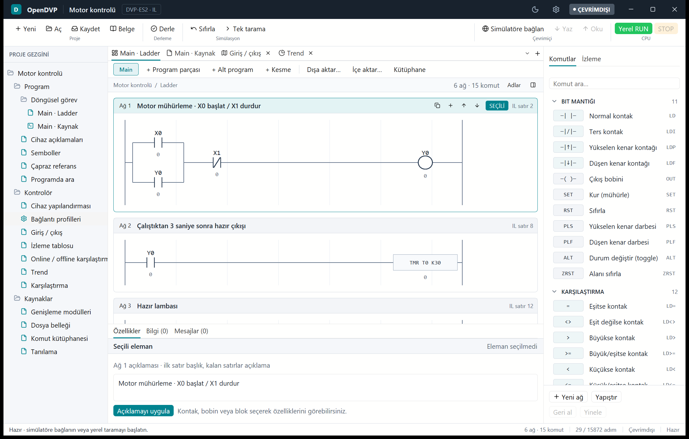
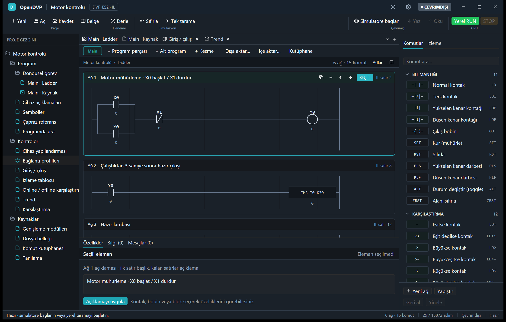

# OpenDVP

[](https://github.com/Gorke07/OpenDVP/releases)


[](LICENSE)

[English](README.md) · [Türkçe](README.tr.md)

**Delta DVP PLC**'ler (ES2 / SS2 sınıfı) için Rust ve [GPUI](https://www.gpui.rs/)
ile yazılmış, açık kaynaklı, önce çevrimdışı çalışan bir programlama çalışma alanı.

Programı Komut Listesi (IL), Structured Text (ST) veya Ladder olarak yazın,
yerleşik tarama simülatöründe çalıştırın, sonucu Delta'nın özgün simülatörüyle
karşılaştırın ve isterseniz gerçek bir denetleyiciyle konuşun. Bir yapay zeka
asistanı, yerleşik MCP sunucusu üzerinden aynı çalışma alanını kullanabilir.

> **Durum: yayın öncesi.** Aşağıdakilerin tümü Delta COMMGR 2.11 ve Delta editörü ile
> gelen Delta simülatörlerine karşı doğrulandı. **Fiziksel bir PLC'ye program
> yükleme, değer zorlama ve RUN/STOP gerçek donanımda henüz denenmedi.**
> Desteklenen tek platform Windows'tur.

<p align="center">
  
  
</p>

**İçindekiler:** [İndir](#indir) · [Özellikler](#özellikler) · [Desteklenen modeller](#desteklenen-modeller) ·
[Derleme](#derleme-ve-çalıştırma) · [Kısa tur](#kısa-tur) · [Structured Text](#structured-text-örneği) ·
[Ayarlar](#ayarlar) · [MCP](#mcp-sunucusu) · [Test](#test) · [Sınırlar](#bilinen-sınırlar)

## İndir

`OpenDVP-0.1.0-windows-x64.zip` dosyasını
[Releases sayfasından](https://github.com/Gorke07/OpenDVP/releases) indirin, açın ve
`opendvp.exe` çalıştırın. Kurulum veya yönetici hakkı gerekmez. SHA-256 değerini aynı
sürümdeki `SHA256SUMS.txt` ile karşılaştırın:

```powershell
Get-FileHash .\OpenDVP-0.1.0-windows-x64.zip -Algorithm SHA256
```

## Özellikler

- **Ladder düzenleyici** – ağ seçimi, seri NO/NC kontak, paralel dal, bobin
  değiştirme, ağ ekleme/silme, geri al/yinele. Her değişiklik önce derlenir;
  derlenmeyen aday kaynağa uygulanmaz.
- **Kaynak editörleri** – IL ve ST; arama (Ctrl+F), cihaz araması, sembol
  adresleri, üretilen IL görünümü ve dışa aktarma. Derleyici ve simülatör
  318 komut ailesini / 600 yazımı kapsar.
- **Structured Text** – `BOOL`, `INT`, `DINT`, `WORD`, `DWORD`, `REAL` ve
  `IF`, `CASE`, `FOR`, `WHILE`, `REPEAT` gibi ifadeler aynı IL yürütme planına
  indirilir. Tam IEC 61131-3 uyumu iddiası yoktur; desteklenmeyen yapılar açık
  hata verir.
- **Tarama simülatörü** – sanal zamanlı yürütme, izleme tablosu, trend (CSV
  dışa aktarma), tanılama, giriş zorlama, modüller (DVP04AD-E2/S2 …) ve dosya
  belleği (`.odmem`).
- **Karşılaştırmalı test** – aynı program özgün Delta ES2/SS2 simülatöründe ve
  yerel modelde çalıştırılır, sonuçlar değer değer karşılaştırılır (`es2_compare`).
- **PLC bağlantısı** – USB/seri ve TCP profilleri, X/Y izleme, SS2 online
  RUN/STOP ve onaylı iki adımlı *program yükleme* (STOP → yaz → geri oku
  doğrula → isteğe bağlı RUN).
- **Dosya biçimleri** – `.odvp` (OpenDVP projesi), `.il`, `.st`, `.odmem`;
  ayrıca Delta `.dvp` ve `.isp` proje dosyaları ile EasyDownload `.dvz` içe aktarma.
- **Yerleşik MCP sunucusu** – yapay zeka asistanı komut rehberini okuyabilir,
  ağ düzenleyebilir, derleyebilir, simüle edebilir ve (yalnız açık onayla) PLC'ye
  dokunabilir. Bkz. [MCP sunucusu](#mcp-sunucusu).
- **Açık / koyu tema**, arayüz ölçeği, otomatik kayıt ve kurtarma kopyaları,
  Türkçe ve İngilizce arayüz.

## Desteklenen modeller

DVP-ES2, ES2-E, EX2, SS2, SA2, SX2, SE, SE2, EH3 ve SV2 profilleri; cihaz aralıkları ve
özel M/D tablolarıyla. Simülatörle doğrulama ES2 ve SS2'yi kapsar; diğer modeller aynı
derleyiciyi kendi sınırlarıyla kullanır.

## Gereksinimler

- Windows 10/11 ve MSVC derleme araçlarıyla Rust (Rust 1.99.1, edition 2024 ile
  doğrulandı).
- Özgün simülatörlerle karşılaştırma için Delta **COMMGR 2.11** (ES2 ve SS2
  simülatörleri) veya Delta editörünün simülatörleri. Pakete *dahil değildir*; yalnızca
  kaynakta kayıtlı SHA-256 değerine sahip ikililer kabul edilir.
- Delta ikilileri ve DLL'leri bu depoya hiçbir zaman eklenmez.

## Derleme ve çalıştırma

```powershell
cargo run --locked --release
cargo run --locked --release -- examples/motor.il      # açılışta dosya aç
cargo build --locked --release                         # target\release\opendvp.exe
```

Çalıştırılabilir dosya **imzasızdır** (v0.1.0); ilk çalıştırmada Windows SmartScreen uyarı verebilir.
İndirdiğiniz sürümü sürümle birlikte yayınlanan SHA-256 değeriyle doğrulayın.

Varsayılan `gpui-ui` özelliği masaüstü uygulamasını derler. İlk derleme GPUI'yi
indirip derlediği için uzun sürer.

## Kısa tur

1. OpenDVP'yi başlatın; motor kontrolü örneğiyle açılır.
2. Sağ panelden **X0** girişini açın ve **F5**'e basın. **Y0** (motor) açılır
   ve kendini mühürler.
3. X0'ı kapatın; mühürleme kontağı motoru açık tutar. 3 sn sonra (T0, K30)
   **Y1** açılır.
4. **X1**'i açın: Y0/Y1 kapanır, T0 sıfırlanır.
5. Derlemek için **F7**, `.odvp` olarak kaydetmek için **Ctrl+S**.

Simülatörde bir adım **20 ms sanal süre** ilerler; gerçek zamanlı yürütme
garantisi yoktur.

| Tuş | İşlem | Tuş | İşlem |
| --- | --- | --- | --- |
| F5 | çalıştır / duraklat | Ctrl+S | kaydet |
| F6 | tek tarama | Ctrl+O | aç |
| F7 | derle | Ctrl+F | kaynakta ara |
| Ctrl+K | komut paleti | F3 / Shift+F3 | sonraki / önceki eşleşme |
| Ctrl+B / Ctrl+J | ağ listesi / denetçi göster-gizle | Ctrl+Z | geri al |

## Structured Text örneği

```iecst
PROGRAM Main
VAR
    start AT X0 : BOOL;
    motor AT Y0 : BOOL;
    count AT D20 : INT := 0;
END_VAR
motor := start;
IF motor THEN
    count := count + 1;
END_IF;
END_PROGRAM
```

X/Y numaraları Delta PLC'lerdeki gibi sekizlik tabandadır (`%IX1.7`, `X17` olur). Daha
fazla program [`examples/`](examples/) klasöründedir.

## Ayarlar

**Ayarlar** sayfası üst çubuktan açılır (güneş/ay simgesi temayı değiştirir).
Dosya `%LOCALAPPDATA%\OpenDVP\settings.txt` konumundadır.

- **Görünüm** – koyu tema, arayüz ölçeği %90–150.
- **Dosyalar ve kurtarma** – kaydedilmemiş değişiklik varken 1/5/10/30 dakikada
  bir kurtarma kopyası (Kaydet kopyayı siler; kopya adsız açılır, orijinalin
  üzerine yazılmaz), varsayılan proje klasörü, son projeler.
- **Yeni proje varsayılanları** – PLC modeli, IL veya ST, simülatör tarama
  süresi (10–100 ms). Var olan projenin modeli, simülatör bağlı değilken
  *Donanım* sekmesindeki CPU kartından değiştirilir.
- **PLC güvenliği** – *salt okunur* anahtarı program yüklemeyi, RUN/STOP'u ve
  zorlamayı (MCP dahil) kapatır. "Varsayılanlara sıfırla" dili, son projeleri ve
  MCP erişim anahtarını korur.
- **Yapay zeka (MCP)** – sunucuyu aç/kapat, port, dinleme kapsamı, erişim anahtarı.

Sürekli online RUN yalnız doğrulanmış COMMGR 2.11 **SS2** simülatöründe vardır;
ES2 modelinde tek tarama karşılaştırması kullanılır. Online RUN için proje
modelini SS2 yapın.

## MCP sunucusu

OpenDVP'nin kendisi bir [MCP](https://modelcontextprotocol.io/) sunucusudur
(`rust-mcp-sdk` 2.x). Ayarlardan açıksa pencereyle birlikte başlar veya tek
başına çalıştırılır:

```powershell
opendvp.exe --mcp-http          # http://0.0.0.0:8765/mcp (akışlı HTTP)
opendvp.exe --mcp-http=9000     # başka port
opendvp.exe --mcp               # stdio taşıması
```

İstemci yapılandırması:

```json
{ "mcpServers": { "opendvp": { "type": "http", "url": "http://127.0.0.1:8765/mcp" } } }
```

Erişim anahtarı varsa `"headers": { "Authorization": "Bearer <anahtar>" }` ekleyin.

Araç grupları: komut rehberi, derleme/kodlama, proje ve ladder ağı düzenleme
(derlenmeyen değişiklik reddedilir), çevrimdışı simülatör, salt okunur PLC
erişimi ve penceredeki projeyi paylaşan `window_project_pull` /
`window_project_push`. PLC'ye yazan araçlar (`plc_download`, `plc_set_run`,
`plc_force`) `confirm=true` olmadan çalışmaz ve *salt okunur* ayarıyla kapanır.

> **Güvenlik.** Varsayılan dinleme kapsamı tüm ağdır (`0.0.0.0`) ve anahtar
> zorunlu değildir. Tam güvenmediğiniz ağlarda kapsamı "yalnız bu bilgisayar"
> yapın veya Ayarlar'dan bir erişim anahtarı oluşturun.

## Depo yapısı

| Yol | İçerik |
| --- | --- |
| `src/` | derleyici, simülatör, protokol kodu, GPUI uygulaması, MCP sunucusu |
| `src/bin/es2_compare/` | özgün simülatörlere karşı karşılaştırmalı testler |
| `examples/` | örnek IL/ST programları ve çalıştırılabilir Rust probları (`cargo run --example …`) |
| `locales/`, `assets/`, `docs/images/` | arayüz çevirileri, simge, Windows kaynakları, ekran görüntüleri |

## Test

```powershell
cargo test --locked --release
cargo clippy --locked --all-targets -- -D warnings
cargo fmt --check
```

Özgün simülatörlere karşı karşılaştırmalı testler (Delta simülatörleri gerekir):

```powershell
cargo run --locked --bin es2_compare -- --output es2-comparison.json
cargo run --locked --bin es2_compare -- --project examples/motor.odvp --scans 10
```

Başarılı bir karşılaştırma yalnızca takımdaki senaryoları kapsar; tüm
komutların veya fiziksel PLC'nin eşdeğerliğini **kanıtlamaz**.

## Bilinen sınırlar

- Yalnız Windows; diğer platformlar derlenip denenmedi.
- Program yükleme, zorlama, RUN/STOP, parola ve modül (CR) erişimi fiziksel
  PLC'de doğrulanmadı; yalnız simülatörler ve yakalanan DVPtool trafiği var.
- Yerel modelin tarama süresi sanaldır; gerçek PLC tarama veya Modbus yanıt
  süresiyle eşleşmez.
- Koyu tema açık paletin renk eşlemesidir; ladder, donanım kartı ve çapraz
  referans gibi özel çizimlerde elden geçirilmemiş tonlar olabilir.
- FTC sayısal hesabı ve bazı operand/model davranışları eksiktir.
- `.isp` projelerindeki FBD/SFC POU'ları dönüştürülmez, not olarak listelenir.

## Lisans

MIT, bkz. [LICENSE](LICENSE).
Delta, DVP, COMMGR ve DVPtool Delta Electronics'in ticari
markalarıdır; bu proje Delta ile bağlantılı değildir ve onun onayını taşımaz.
